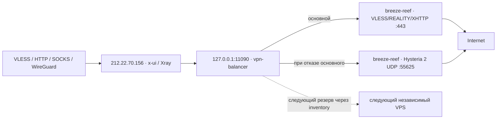

# VPN: балансировка, мониторинг и развёртывание

Рабочие настройки и автоматизация сохранены в этом проекте. Публичная часть готова к GitHub; действующие пароли, UUID, ключи REALITY, TLS и базы x-ui находятся только в `.local/`, которая исключена из Git.

Репозиторий: [Ja1rman/vpn](https://github.com/Ja1rman/vpn). Развёртывание подготовлено через GitHub Actions и Environment `production`; секреты передаются через переменные окружения из GitHub Secrets. Оба workflow запускаются только вручную, deploy дополнительно выключен `VPN_DEPLOY_ENABLED=false`. CI пока не запускался и не тестировался по просьбе владельца. [Настройка Secrets, запуск и компоненты deploy](docs/ci.md).

## Текущая схема



| Роль | Хост | SSH | Развёрнуто |
|---|---|---|---|
| Вход, балансировщик, мониторинг | `212.22.70.156` | `marat` + sudo | существующий x-ui, отдельный Xray, Docker Compose |
| Выход в Нидерландах | `144.31.34.165` (`breeze-reef`) | `root` | существующий x-ui, Node Exporter |

`back` / `lonelycraft.ru` не относится к этой инфраструктуре и не изменялся.

**Физический выходной сервер пока один.** VLESS и Hysteria на нём дают два транспорта. При полном отказе Нидерландов резервного выхода сейчас нет. После добавления независимого VPS балансировщик автоматически исключит недоступный выход и продолжит новые соединения через оставшиеся.

Входной `212.22.70.156` также остаётся единственной точкой входа. Чтобы пережить его полный отказ, нужны второй вход и поддерживающий автоматическое переключение клиентский профиль. Один WireGuard Endpoint сам по себе не переключается между серверами. Уже оборванные TCP-соединения при отказе выходного узла приложения устанавливают заново; время обнаружения зависит от проверки и сетевого тайм-аута, обычно десятки секунд.

## Внешний доступ и реквизиты

- [Grafana](http://212.22.70.156/grafana/) — форма входа, дашборд **VPN → VPN — серверы и сетевой трафик**.
- [Alertmanager](http://212.22.70.156/alerts/) — HTTP Basic Auth.
- [Prometheus](http://212.22.70.156/prometheus/) — HTTP Basic Auth.

Логин — **`admin`**. Сложный случайный пароль: **`.local/access.md`** и `.local/access.json`. В GitHub эти файлы не попадают. Grafana и HTTP Basic Auth используют одинаковые реквизиты. HTTP открыт по запросу владельца; данные и пароль передаются без TLS. Для использования в недоверенных сетях можно сохранить SSH-туннель или добавить HTTPS на reverse proxy.

Чтобы сменить пароль или логин, измените поле в `.local/access.json`, затем выполните `render.py` и `refresh-grafana`. Текущий логин определяется по установленному файлу и меняется через API. Сохраняйте длину пароля не менее 24 случайных символов.

Порты `3000`, `9090`, `9093`, `9115`, `11090`, `11091` слушают только loopback. Публичен nginx на TCP `80`. Node Exporter на выходном VPS использует TCP `19100` с обязательным клиентским TLS-сертификатом; на входном сервере этот порт доступен только через loopback. Существующий firewall и сетевые настройки VPN не изменялись.

SSH-туннель при необходимости:

```bash
python3 scripts/vpnctl.py tunnel
```

## Что изменено в VPN

Основной Xray не перезапускался. Балансировщик `vpn-balancer.service` — отдельная копия проверенного Xray `26.10.10`. Он принимает SOCKS5 TCP/UDP на `127.0.0.1:11090` и отправляет трафик через зашифрованные выходы.

Outbound `vpn-egress-pool` направляет все десять действующих клиентских входов в пул. Первые шесть правил переведены через API x-ui; ещё четыре прежних прямых входа — через RoutingService Xray без перезапуска:

| Inbound tag | Назначение |
|---|---|
| `in-33172-tcp` | VLESS / REALITY |
| `in-47070-udp` | WireGuard |
| `in-58663-tcp` | HTTP proxy |
| `in-53715-tcpudp` | Shadowsocks |
| `in-48360-udp` | локальный SOCKS-мост |
| `in-46738-tcp` | VLESS |
| `in-26279-tcp` | HTTP proxy, прежний порт `26279` |
| `in-48607-tcp` | HTTP proxy, прежний порт `48607` |
| `in-13298-tcp` | HTTP/SOCKS, прежний порт `13298` |
| `in-36307-udp` | WireGuard, прежний порт `36307/UDP` |

Адрес `212.22.70.156`, порты, пароли, UUID и WireGuard-ключи/peers сохранены. Клиентские профили менять не нужно. Общие правила API, блокировки private-сетей и BitTorrent сохранены перед правилами входов. Исходные NL-outbounds и outbound `direct` оставлены в x-ui для отката; для перечисленных входов новые соединения выбирают пул. У SOCKS `13298` UDP был выключен и остался выключенным.

Соединения, открытые до переключения, продолжают работать по прежнему пути до завершения; новые соединения сразу используют пул. Принудительный разрыв старых сессий не выполняется. Профиль с прямым адресом `144.31.34.165` по-прежнему подключается непосредственно к NL и не проходит через входной сервер.

Режим — **`priority`: основной и резервные выходы**, без чередования пользовательских соединений. Порядок по умолчанию задаётся списком `nodes` в inventory, затем индексами `outbounds` внутри каждого узла. Для изменения приоритета транспорта без смены его tag есть `balancer.priority_order`. Сейчас все новые соединения идут через NL VLESS; Hysteria используется только при его недоступности. Новый физический VPS, добавленный в конец списка, станет следующим резервом после обоих транспортов NL.

Observatory каждые `10s` параллельно проверяет доступность выходов. Выбирается первый доступный по порядку; задержка переключения включает проверку и сетевой тайм-аут. При восстановлении более приоритетного выхода **новые** соединения возвращаются на него. Уже открытые соединения продолжаются до завершения, пока их сервер доступен; оборванные при реальном отказе сессии переподключает приложение. Смены выходного IP при настоящем отказе/восстановлении избежать нельзя; постоянной ротации IP между здоровыми хостами нет.

На каждой ступени Xray настроен с одним кандидатом; `fallbackTag` ведёт через внутренний Loopback к следующей ступени, последняя — в `blocked`. Запись `roundRobin` внутри такой ступени выбирает единственный tag и не распределяет запросы. При отказе всех выходов прямого обхода VPN нет. Резерв может показывать небольшой трафик проверок и старых, ещё не закрытых сессий. [Приоритеты, проверки и откат](docs/failover.md).

## Файлы и источник правды

| Путь | Назначение |
|---|---|
| `inventory/hosts.json` | SSH-адреса, интерфейсы, бюджет канала, список узлов, ссылки на private outbounds |
| `.local/outbounds/*.json` | реальные реквизиты выходов; текущее подключение импортировано из x-ui |
| `scripts/render.py` | генерация конфигурации пула, целей Prometheus, сетевых лимитов и access-файлов |
| `scripts/priority_pool.py` | основной и резервные выходы: цепочка с одним кандидатом на ступень |
| `scripts/certificates.py` | CA и клиентские/серверные mTLS-сертификаты Node Exporter |
| `scripts/vpnctl.py` | резервные копии, доставка, установка, hot reload, SSH и туннели |
| `scripts/add_host.py` | подключение существующего выхода или установка нового VLESS/REALITY VPS |
| `monitoring/` | Compose, nginx, правила алертов, Grafana provisioning и JSON-дашборд |
| `.local/rendered/` | сгенерированный private deployment bundle |
| `.local/backups/` | согласованные SQLite snapshots, конфигурации и автоматизации серверов |
| `.local/pki/` | CA и TLS-ключи; **закрытый CA-ключ остаётся на ноутбуке** |
| `.local/runtime/` | копия Xray и geodata для восстановления/новых узлов |

Рабочие пути: `/etc/vpn-balancer/`, `/opt/vpn-balancer/`, `/etc/vpn-node/`, `/etc/vpn-monitoring/`. Доставка выполняется в закрытую staging-папку `/opt/vpn-infra/staging/`. Существующий x-ui хранит базу в `/etc/x-ui/x-ui.db`, сгенерированный runtime JSON — в `/usr/local/x-ui/bin/config.json`.

**Не редактируйте runtime JSON основного Xray вручную:** x-ui его пересоздаёт. Обычные изменения его шаблона делаются через x-ui/API. Для четырёх прежних прямых входов предусмотрена команда `migrate-direct-inbounds`: она применяет только routing через gRPC, сохраняет только `xrayTemplateConfig` транзакцией SQLite с проверкой прежнего значения и синхронизирует только routing в runtime JSON. База не подменяется; клиенты и входы не редактируются. Такой путь исключает fallback x-ui на перезапуск. При следующей сборке x-ui читает сохранённый шаблон из БД. Состав отдельного пула управляется этим проектом.

## Обычные изменения

На ноутбуке нужны Python 3.10+, OpenSSH, OpenSSL и `htpasswd` (на macOS уже есть; на Linux пакет `apache2-utils`). Для входа по сохранённому паролю используется `sshpass`. На серверах — Linux x86_64, Python 3 и root либо sudo без пароля. Docker Compose требуется на входном сервере; автоматизация не устанавливает Docker и не перезапускает его.

```bash
# После изменения inventory или monitoring:
python3 scripts/render.py
python3 scripts/certificates.py

# Добавления/удаления в пуле — через API, без остановки основного VPN:
python3 scripts/vpnctl.py update-pool

# Однократный перевод четырёх прежних прямых входов; повторный запуск проверяет маршруты:
python3 scripts/vpnctl.py migrate-direct-inbounds

# Обновление правил, дашборда, targets и внешнего доступа:
python3 scripts/vpnctl.py deploy-monitoring

# Если изменились бюджет канала / сертификаты exporter:
python3 scripts/vpnctl.py deploy-node entry
python3 scripts/vpnctl.py deploy-node breeze-reef
```

Имена узлов уникальны. Если меняются реквизиты существующего выхода, сначала добавьте его с новым именем, проверьте, затем уберите старый. `update-pool` проверяет новые выходы до включения, отказывается менять обработчик с действующими сессиями и сохраняет удалённые runtime-обработчики до следующего перезапуска, чтобы соединения могли завершиться.

`update-pool` сохраняет private снимки до/после на сервере, включает 90-секундный watchdog и подтверждает обновление после TCP/UDP-проверок и проверки неизменности PID балансировщика. Неподтверждённое изменение откатывается без перезапуска. Порядок резервов можно менять через inventory → render → update-pool; клиентские настройки остаются прежними.

Параметры Observatory, listen-порты и другие разделы вне routing/outbounds нельзя менять через `update-pool`: он отклонит такую правку. Для них потребуется отдельное окно обслуживания с перезапуском **только балансировщика**. `deploy-balancer` предназначен для первоначальной установки.

## Добавить ещё один хост

Сначала проверьте отпечаток SSH-ключа у провайдера и добавьте подтверждённый ключ в `.local/ssh/known_hosts`. Не отключайте проверку SSH-ключей. Можно использовать SSH-agent/ключи, либо создать файл `.local/ssh/ИМЯ.password` с правами `600`.

### Новый чистый VPS

Пример с документационным IP: замените его на реальный адрес. На VPS должен быть свободен порт TCP `443`, а firewall провайдера должен пропускать TCP `443` и TCP `19100` от сервера мониторинга.

```bash
python3 scripts/add_host.py \
  --name exit-de-1 --address 203.0.113.10 --user root \
  --network-budget-mbps 1000 --provision
python3 scripts/vpnctl.py deploy-monitoring
```

Будут сгенерированы новые UUID/ключи REALITY, установлен отдельный `vpn-exit.service`, Node Exporter с mTLS и добавлен проверенный outbound в пул. Используется сохранённая копия действующего Xray; при отсутствии локальной копии она берётся со входного сервера. Порт и SNI можно задать через `--port` и `--sni`. Существующий сервис/занятый порт не перезаписываются.

### Уже работающий x-ui на новом хосте

Экспортируйте **клиентский outbound** нового сервера в private JSON. Нужны его UUID, транспорт, REALITY public key/short ID/SNI или TLS-настройки. Пример структуры — в `.local/outbounds/`.

```bash
python3 scripts/add_host.py \
  --name exit-de-1 --address 203.0.113.10 --user root \
  --network-budget-mbps 1000 --outbound .local/new-exit.json
python3 scripts/vpnctl.py deploy-monitoring
```

Основной x-ui на новом хосте при импорте не меняется. Новый native bootstrap подготовлен для следующего VPS; на существующих серверах он не запускался. Hot reload действующего пула проверен на рабочем сервере.

### Удалить или временно исключить узел

Уберите его из `nodes` в inventory, выполните `render.py`, `certificates.py`, `update-pool`, затем `deploy-monitoring`. Проверки мониторинга для этого узла исчезнут, новые соединения перестанут на него направляться. Старый VPS можно выключать после завершения сессий. На удалённом VPS сервисы автоматически не удаляются.

## Мониторинг и алерты

В папке **VPN** доступны пять дашбордов. На каждом есть выбор серверов, периода и ссылки на остальные разделы:

| Дашборд | Содержимое |
|---|---|
| [Обзор](http://212.22.70.156/grafana/d/vpn-infrastructure/) | Доступность, основные ресурсы, трафик и активные алерты |
| [CPU](http://212.22.70.156/grafana/d/vpn-cpu/) | Загрузка по ядрам и режимам, iowait/steal, load, процессы, переключения контекста и CPU pressure |
| [RAM и swap](http://212.22.70.156/grafana/d/vpn-memory/) | MemAvailable, cache/buffers, swap, page faults и memory pressure |
| [Диски](http://212.22.70.156/grafana/d/vpn-disks/) | Место и inode по файловым системам, чтение/запись, IOPS, задержки, занятость диска и очередь |
| [Сеть и TCP](http://212.22.70.156/grafana/d/vpn-network/) | RX/TX, объём за период, пакеты, ошибки, потери, бюджет канала и TCP retransmits |

Генератор подробных дашбордов — `scripts/build_dashboards.py`, результат хранится в `monitoring/grafana/dashboards/*.json`. Обновление без перезапуска Grafana, Prometheus и VPN:

```bash
python3 scripts/build_dashboards.py
python3 scripts/render.py
python3 scripts/vpnctl.py refresh-grafana
```

Файловый provisioner подхватывает JSON в течение 30 секунд. Для дисков есть отдельные фильтры устройства и точки монтирования, для сети — интерфейс. Ручные изменения provisioned-дашбордов нужно вносить в проект.

| Алерт | Условие |
|---|---|
| `NodeUnavailable` | exporter недоступен 2 минуты |
| `VpnPortUnavailable` | TCP-порт VPN недоступен 1 минуту |
| `VpnEgressUnavailable` | запрос в интернет через пул не проходит 1 минуту |
| `HighCPU` | CPU >85% в течение 10 минут |
| `HighMemory` | RAM >90% в течение 10 минут |
| `DiskSpaceLow` | свободно <15% на `/` в течение 10 минут |
| `HighNetworkTraffic` | RX+TX >85% настроенного бюджета 10 минут |
| `MonitoringComponentUnavailable` | компонент мониторинга не отвечает 2 минуты |
| `PrometheusConfigReloadFailed` | ошибка перечитывания конфигурации |
| `AlertDeliveryFailed` | ошибки отправки уведомлений |

В `inventory/hosts.json` бюджет обоих каналов пока задан **условно как 1000 Мбит/с**, поскольку тариф провайдера неизвестен. Это допустимая **сумма RX+TX**, а не автоматически определённая скорость виртуальной сетевой карты. Измените `network_budget_mbps` по тарифу и нужному порогу; для независимых full-duplex направлений можно задать суммарный бюджет вдвое выше скорости одного направления.

Prometheus хранит до 15 дней и до 1 ГБ TSDB; с учётом WAL фактический каталог может быть больше. Контейнеры имеют лимиты памяти/CPU. После установки диск входного сервера был заполнен на 92%. Разовая очистка старых journal-файлов и неиспользуемого build cache снизила заполнение до 84% и освободила около 9,63 ГиБ; данные приложений и Docker-образы сохранены. Подробности: [обследование и очистка диска](docs/disk-maintenance.md).

Prometheus отправляет алерты в Alertmanager; включена почтовая доставка и уведомления о восстановлении двум получателям через существующий Mailu SMTP по TLS465. Адреса и реквизиты хранятся в `.local/smtp.json`, итоговый YAML — в `.local/alertmanager.yml` и Secret `production/VPN_ALERTMANAGER_CONFIG`. `render.py` автоматически применяет private override; публичный шаблон остаётся web-only. Настройки mail-хоста не менялись. [Изменить почту, применить без перезапуска и выполнить откат](docs/email.md).

Если выключен сам сервер мониторинга, он не сможет показать новый алерт о собственном отказе. Для этого нужен независимый внешний наблюдатель/второй Prometheus. mTLS-сертификаты exporter действуют 397 дней. Для обновления сохраните CA, удалите только соответствующие leaf `cert.pem` в `.local/pki/ИМЯ/` и/или `.local/pki/client/`, запустите `certificates.py`, затем `deploy-node` и `deploy-monitoring`. Закрытый CA-ключ не пересоздавайте при обычной ротации.

## Резервные копии и откат

```bash
python3 scripts/vpnctl.py backup entry
python3 scripts/vpnctl.py backup breeze-reef
```

SQLite сохраняется через online backup API, поэтому копия согласована с WAL и VPN не останавливается. Сохраняются конфигурации, TLS/acme, systemd и существующие VPN-мосты. История метрик и содержимое Docker volumes в этот архив не входят. Исходные копии до изменений: `.local/backups/entry-before.tar.gz` и `.local/backups/nl-before.tar.gz`.

При активации пула был включён независимый 90-секундный watchdog: неподтверждённое изменение автоматически откатывалось через x-ui. Успешная активация: `/var/backups/vpn-infra/20261016T112818Z` на входном сервере.

Быстрый ручной возврат шести маршрутов на прежний NL VLESS:

```bash
python3 scripts/vpnctl.py ssh entry
sudo python3 /opt/vpn-infra/staging/entry/activation/activate_balancer.py \
  rollback /var/backups/vpn-infra/20261016T112818Z
```

Это возвращает сохранённый шаблон x-ui через API; базу пользователей не подменяет. После последующих ручных изменений шаблона сначала сохраните свежую копию, чтобы не вернуть устаревшие правила. `activate-balancer` умеет повторно включить пул.

Последующий перевод HTTP `26279/48607`, HTTP/SOCKS `13298` и WireGuard `36307` сохранён в `/var/backups/vpn-infra/routes-20261016T125200Z`. В каталоге лежат шаблон/runtime до и после, отчёт и отметка `committed`. Независимый watchdog возвращает только маршрутизацию, если проверка не завершена за 180 секунд. Ручной откат именно этого перевода без перезапуска:

```bash
sudo python3 /opt/vpn-infra/staging/entry/route-migration/migrate_direct_inbounds.py \
  rollback /var/backups/vpn-infra/routes-20261016T125200Z
```

Команда проверяет, что шаблон и runtime не изменены после перевода, и отказывается затирать чужие изменения. Откат первых шести правил из более раннего снимка вернёт весь старый шаблон, включая отсутствие новых четырёх правил; используйте соответствующий снимок и сначала сделайте свежий backup.

Для аварийного восстановления с нуля нужны private backup, `.local/outbounds`, `.local/pki`, `.local/access.json` и runtime Xray. Полное восстановление SQLite/сертификатов существующего x-ui выполняйте в окно обслуживания с остановкой x-ui. Не подменяйте живую БД и не распаковывайте весь архив поверх `/` без проверки списка файлов. Установка инфраструктурных сервисов воспроизводится командами `deploy-node`, `deploy-balancer`, `deploy-monitoring`, затем `activate-balancer` и `migrate-direct-inbounds`; версия/установка самого x-ui остаётся отдельной зависимостью, его автообновление этим проектом не выполняется.

## Проверки и публикация в GitHub

```bash
python3 -m unittest discover -s tests -v
for script in scripts/*.sh; do bash -n "$script"; done
```

Ручной workflow Validate содержит `promtool test rules tests/alerts.test.yml`, Python safety-тесты и shell syntax. В рамках публикации этот workflow не запускался. На сервере доступны `scripts/verify_vpn.py` (временный VLESS-клиент, TCP + UDP DNS), `scripts/test_priority_failover.py` (три временных выхода, приоритеты, отказы, восстановление и UDP) и `scripts/verify_priority_backup.py` (реальный резерв в изолированном клоне). Они не останавливают рабочие VPN-сервисы. Подробности — в [документации failover](docs/failover.md).

Образы закреплены digest в Compose, Node Exporter — версией и SHA-256. Все десять целей Prometheus и внешний вход проверены. Последние результаты: `docs/verification.md`.

Перед публикацией:

```bash
git status --short
git check-ignore .local/access.json .local/outbounds/breeze-reef-vless.json
# Добавляйте только публичные README/docs, inventory, scripts, monitoring, tests, .github и .gitignore.
```

`.local/` отдельно сохраните в защищённый бэкап: одного публичного репозитория недостаточно для восстановления действующих ключей и пользователей. GitHub Secrets содержат только данные для обновления инфраструктуры, без базы x-ui, её клиентских ключей и закрытого ключа CA.
