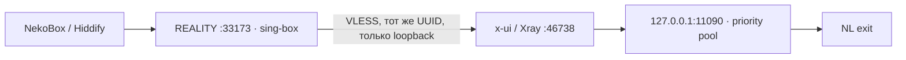

# Android VLESS и производительность: 20 октября 2026

## Что выбрать на телефоне

Обновите существующую подписку в NekoBox или Hiddify. Выберите **`mc-ubuntu-breeze-reef-android-…`**: VLESS/REALITY, адрес входного сервера `212.22.70.156`, TCP `33173`, SNI `yandex.ru`, fingerprint `chrome`, XUDP. UUID, REALITY key и short ID импортируются из подписки; вручную публиковать их не нужно.

Старый `mc-ubuntu-breeze-reef-…` на `33172` оставлен для совместимых Xray-клиентов. Обычный VLESS `46738`, Shadowsocks `53715` и все остальные существующие входы сохранены. В девяти доступных подписках старые 3/5 ссылок сохранены, добавлена одна новая: теперь 4/6 ссылок.

## Почему прежний REALITY не работал

Проверка официальным sing-box 1.14.3 с ноутбука воспроизвела отказ `33172` с fingerprint Firefox и Chrome; обычный VLESS через тот же пул работал. Публичный ключ REALITY соответствует private key, пользователи активны, сроки/лимиты доступа не исчерпаны.

REALITY-библиотека установленного Xray 26.10.10 требует X25519MLKEM768 в ClientHello. Клиент REALITY в sing-box/Hiddify удаляет этот key share. Поэтому смена SNI или UUID сама по себе не исправляет этот отказ. Источники: [изменение REALITY](https://github.com/XTLS/REALITY/commit/8cdf7bf9c7f0), [sing-box REALITY client](https://github.com/SagerNet/sing-box/blob/v1.14.3/common/tls/reality_client.go), [сообщение Hiddify](https://github.com/hiddify/hiddify-app/issues/2384).

Новый frontend использует отдельный sing-box **1.14.3**, официальный Linux amd64 архив SHA256 `e2bdf179c15a3652955dc44867e33ca0965c9c9b91b34267dcc5a5d639a5feee`. Основные Xray не обновлялись и не перезапускались.

## Как сохраняются авторизация и учёт



У каждого frontend-пользователя отдельный VLESS outbound с тем же UUID на `127.0.0.1:46738`; неизвестный пользователь не может попасть в outbound другого клиента. Catch-all правило отклоняет непредусмотренный маршрут. Прямого доступа frontend к интернету или SOCKS-пулу нет. Основной Xray проверяет действующие права, применяет отключение/сроки/квоты и учитывает трафик как обычный VLESS `46738`.

Для копирования клиент должен присутствовать в обоих входах `33172` и `46738`, быть активным и не исчерпать лимиты. Состав UUID frontend — снимок: новый пользователь или смена UUID требуют явной сверки и планового обновления только дополнительной службы. Installer отказывается менять отличающийся существующий конфиг. Автоматического перезапуска при изменении клиентов нет. После отзыва UUID в основном Xray frontend не даёт обойти его авторизацию.

Основной Xray видит frontend-соединения с loopback: ограничения по исходным IP телефона нельзя считать эквивалентными прямому входу. У текущих девяти клиентов `limit_ip=0` и `limit_hwid=0`. Учитывайте это при включении таких ограничений.

## Воспроизвести установку

На ноутбуке получите официальный архив в закрытую папку, затем используйте helper. Installer сам сверяет SHA256 и версию, проверяет конфиг, создаёт только новую службу. Повторный запуск при полном совпадении ничего не перезапускает.

```bash
mkdir -p .local/compatible-vless
gh release download v1.14.3 --repo SagerNet/sing-box \
  --pattern sing-box-1.14.3-linux-amd64.tar.gz --dir .local/compatible-vless
python3 scripts/vpnctl.py deploy-compatible
# После проверки нового входа:
python3 scripts/vpnctl.py publish-compatible
```

Пути: `/etc/vpn-compatible-vless/config.json` (0640), `/opt/vpn-compatible-vless/sing-box`, `vpn-compatible-vless.service`. Отдельный системный пользователь не имеет доступа к БД x-ui. Renderer читает БД от root только при ручном запуске. Профили публикуются добавлением строк `kind=link` в `client_external_links`; исходные inbounds и клиенты не меняются.

Текущая публикация: `/var/backups/vpn-infra/compatible-profiles-20261020T110330442558Z`. Для удаления только добавленных неизменённых ссылок:

```bash
sudo python3 /opt/vpn-infra/staging/entry/compatible-vless/compatible_profiles.py \
  rollback --backup /var/backups/vpn-infra/compatible-profiles-20261020T110330442558Z
```

Откат откажется удалять изменённую владельцем строку и не подменяет БД. Удаление ссылок не закрывает действующие соединения. Останавливать дополнительную службу следует только после перехода пользователей на другой профиль; основной VPN для этого останавливать не требуется.

## Скорость и резерв

Небольшие загрузки Cloudflare по 5 МБ дали следующие результаты, включая установление соединения:

| Путь | Скорость |
|---|---|
| Основной entry → NL XHTTP443 | 65–69 Мбит/с |
| Новый entry → NL TCP8443 | 57–59 Мбит/с |
| Hysteria55625 | 0,7–0,9 Мбит/с, тесты завершились по тайм-ауту |
| NL → интернет напрямую | 366–422 Мбит/с |

Основной канал оставлен прежним. На NL добавлен отдельный `vpn-exit.service` с новым служебным UUID и REALITY key, TCP `8443`, Xray 26.10.10. Первый резерв теперь `pool-breeze-reef-tcp-v1`; Hysteria остаётся последним резервом. Исправный основной не чередуется с резервами. Все три транспорта используют один физический VPS: это не резервирование полного отказа NL.

В журнале 20 октября был краткий переход на Hysteria в 12:37 МСК. Его низкая скорость могла вызвать отдельные задержки видео, но установить причину каждого зависания телефона без клиентской трассы нельзя. За сутки постоянной загрузки CPU/диска/сетевых очередей не обнаружено. 19 октября вечером CPU steal NL достигал около 19% — возможна конкуренция у провайдера. TCP RTT entry–NL около 48 мс. Оснований менять глобальные MTU, congestion control или firewall не найдено.

На новых портах включены TCP-проверки Prometheus. Для изменения списка используйте `vpn_probe_ports` в inventory, `render.py`, затем `vpnctl.py refresh-probes`; file_sd подхватывает изменения без перезапуска.

## ChatGPT Android

На NL DNS/TCP/TLS до доменов OpenAI работают через IPv4 и IPv6. `/cdn-cgi/trace` отвечает 200, регион NL. `android.chat.openai.com` возвращает диагностическому запросу 403 с `Request is not allowed. Please try again later.` и `type: dc`; web/auth endpoints возвращают Cloudflare challenge. Официального объяснения значения `dc` не найдено. Запрос без авторизации не доказывает, что реальный запрос приложения отклонён по той же причине.

Это не подтверждённый отказ транспорта Shadowsocks. Новый профиль нужно проверить именно в приложении на телефоне. Если блокировка сохраняется, потребуется сравнение с браузером/другой сетью либо выход с другим IP/провайдером; на текущем единственном NL IP смена протокола не гарантирует результата. Специального прямого обхода VPN для ChatGPT не добавлялось. Источники: [сеть ChatGPT и приложения](https://help.openai.com/en/articles/9247338-network-recommendations-for-chatgpt-errors-on-web-and-apps), [Cloudflare-блокировки и VPN](https://help.openai.com/en/articles/7967834-why-am-i-getting-sorry-you-have-been-blocked-error).

Дополнительная проверка Shadowsocks/sing-box 1.14.3: Google 204 проходит примерно за 296 мс и UDP DNS работает, однако несколько других HTTPS-направлений завершились TLS-тайм-аутом. Маршрутизация SS и обычного VLESS одинакова; параметры из подписки соответствуют runtime. Полного отказа SS нет, но причина ошибки приложения пока не доказана только HTTP-ответом `403`. В более новом Xray есть [исправление SS2022 interrupt](https://github.com/XTLS/Xray-core/pull/7143); связь с этими тайм-аутами не установлена. Основной core ради проверки этой гипотезы не обновлялся: это потребовало бы остановки VPN. Совместимый VLESS предоставляет проверенный альтернативный путь через тот же основной Xray.

## Проверки и секреты

Совместимый вход прошёл HTTPS и UDP DNS для девяти UUID с отдельного sing-box на ноутбуке. Девять подписок сохранили старые ссылки и выдают новый Android-профиль. Основной runtime и настройки авторизации не изменились; исходные 36 сервисов и 11 контейнеров сохранили PID/время запуска. Горячее добавление TCP-резерва пережил уже открытый HTTPS CONNECT на том же TLS-сокете. Проверка реального TCP-резерва с искусственным отказом основного в отдельном клоне: четыре HTTPS и четыре UDP DNS успешно.

Изменения инфраструктуры отражены в private `.local/diagnostics/20261020/`, `.local/outbounds/` и резервных копиях. Секреты в публичный Git не добавляются. CI остаётся ручным и выключенным; он в этой работе не запускался. Дополнительный frontend разворачивается указанными ручными helper-командами; существующий CI-компонент `pool` обновляет очередь резервов, но не устанавливает frontend или выход с нуля.
